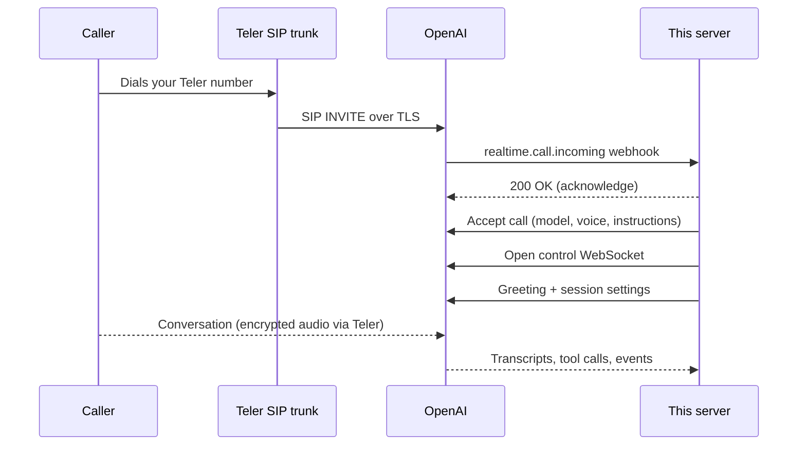

# Teler OpenAI SIP Trunking

A reference integration that routes inbound calls on a **FreJun Teler** number straight to an **OpenAI Realtime** voice agent over SIP.

## What is Teler?

Teler is a programmable voice API by FreJun. It handles carriers, phone numbers, SIP trunking, and real-time audio streaming so you can connect AI models directly to phone calls. → [frejun.ai](https://frejun.ai)

## About

Most Teler integrations stream call audio to your server over a WebSocket, and your server relays it to the AI provider. This one takes a shorter path: the Teler SIP trunk hands the call to OpenAI's SIP endpoint, and audio travels directly between Teler and OpenAI.

Your server stays out of the audio path entirely. Its job is call control: it's told when a call arrives, decides to answer it, configures the agent, and follows the conversation as it happens. That means no audio resampling, no media buffers to tune, and far less to scale.

---

## Features

- **Direct SIP handoff.** Calls go from the Teler trunk to OpenAI with no media relay to host.
- **Answer in the background.** The webhook replies to OpenAI immediately; the call is answered in a background task.
- **Secure by default.** Every webhook is signature-checked, and repeated deliveries of the same event are ignored.
- **Agent speaks first.** A configurable greeting plays as soon as the call connects.
- **Live transcripts.** Both sides of the conversation are written to the logs as they happen.

---

## How it works



1. A caller dials your Teler number, which is assigned to a SIP trunk.
2. The trunk forwards the call to your OpenAI project's SIP address.
3. OpenAI notifies this server with a `realtime.call.incoming` webhook.
4. The server answers with an accept request that sets the model, voice, and instructions.
5. The server opens a control WebSocket for that call, sends the greeting, and listens for transcripts and tool calls.
6. The caller and the agent talk. The audio never passes through this server.

---

## Prerequisites

- Python 3.10+
- An **OpenAI** project, with its API key and project ID (`proj_...`). The project ID is under **Settings → Project → General**.
- A **FreJun Teler** account with a phone number and permission to set up SIP trunks.
- A public HTTPS address so OpenAI can reach your webhook. During development, [ngrok](https://ngrok.com) works well.

---

## Setup

### 1. Clone and install

```bash
git clone https://github.com/frejun-tech/teler-openai-sip-trunking.git
cd teler-openai-sip-trunking
python -m venv .venv
source .venv/bin/activate        # Windows: .venv\Scripts\activate
pip install -r requirements.txt
```

### 2. Add a webhook in OpenAI

Go to **Settings → Project → Webhooks** in the OpenAI platform and create a webhook:

- **URL:** `https://<your-public-domain>/openai-webhook`
- **Event:** `realtime.call.incoming` (this is the only event the server needs)

OpenAI displays the signing secret (`whsec_...`) once, right after you create the webhook. Save it for the next step.

### 3. Point your Teler SIP trunk at OpenAI

In your Teler SIP trunk settings, send inbound calls to this address, using your own project ID:

```
sip:proj_XXXXXXXX@sip.api.openai.com:5061;transport=tls
```

For EU data residency, replace `sip.api.openai.com` with `sip-eu.api.openai.com`.

On the same trunk:

- Set the transport to **TLS**.
- Turn on **SRTP** so call audio is encrypted. OpenAI requires encrypted audio, and TLS by itself only protects the signaling.
- Assign your Teler phone number to the trunk.

### 4. Create your `.env` file

```ini
OPENAI_API_KEY=sk-...
OPENAI_WEBHOOK_SECRET=whsec_...
AI_GREETING=Thank you for calling, how can I help you?
AI_INSTRUCTIONS=You are a helpful phone assistant.
```

See [Environment Variables](#environment-variables) for everything you can set.

### 5. Start the server

```bash
uvicorn main:app --port 8000
```

In a second terminal, expose it publicly:

```bash
ngrok http 8000
```

Use the ngrok address plus `/openai-webhook` as your webhook URL in step 2. A free ngrok address changes whenever ngrok restarts, so update the webhook when that happens.

### 6. Make a test call

- In the OpenAI webhook settings, use **Send test event**. The server should respond with `200`.
- Call your Teler number. Within a few seconds, the agent should pick up and greet you.

---

## Environment Variables

| Variable | Description | Default |
| --- | --- | --- |
| `OPENAI_API_KEY` | API key from the same OpenAI project the trunk routes to | Required |
| `OPENAI_WEBHOOK_SECRET` | Signing secret from your OpenAI webhook | Required |
| `AI_MODEL` | Realtime model that runs the conversation | `gpt-realtime-2.1` |
| `AI_VOICE` | Voice the agent speaks with | `alloy` |
| `AI_INSTRUCTIONS` | System instructions for the agent | `You are a helpful phone assistant.` |
| `AI_GREETING` | First thing the agent says when the call connects | `Thank you for calling, how can I help you?` |
| `TRANSCRIBE_MODEL` | Model used to transcribe the caller's speech | `whisper-1` |

---

## API Endpoints

- `POST /openai-webhook` - Receives `realtime.call.incoming` events from OpenAI
- `GET /health` - Service status

---

## Project Structure

```
├── main.py            # Webhook handler, call accept, control WebSocket
├── requirements.txt
├── .env               # Your credentials (keep out of version control)
└── README.md
```

---

## Troubleshooting

**The call never reaches OpenAI.**
Make sure the SIP address on your trunk includes `:5061`, and that the trunk transport is TLS. OpenAI only listens for SIP on port 5061 over TLS.

**The call connects, but I hear nothing.**
SRTP is probably off on the trunk. With TLS on and SRTP off, the call can connect normally but carry no audio.

**OpenAI's test event works, but real calls never trigger the webhook.**
Check that the project ID in the trunk's SIP address is the same project that owns your webhook and API key, and that your Teler number is assigned to that trunk.

**The webhook returns `400`.**
The signature check failed. Confirm `OPENAI_WEBHOOK_SECRET` is correct and that the variable names in `.env` are uppercase with no spaces.

**The webhook returns `404`.**
The request isn't reaching this app. Open `http://127.0.0.1:8000/docs` and confirm `POST /openai-webhook` is listed, and check that ngrok forwards to port 8000.

**uvicorn says it can't import the module.**
Run `uvicorn main:app`: the file name without `.py`, followed by `:app`.

---

## Resources

- [OpenAI: Telephony and SIP](https://developers.openai.com/api/docs/guides/voice-sip)
- [FreJun Teler documentation](https://www.frejun.ai/docs/)
- Support: support@frejun.com

## License

MIT
